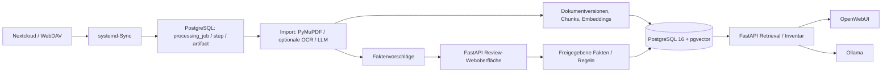

# Retro-RAG V2

Lokales RAG-System für Retro-PC-Hardware. Es beantwortet Fragen im Chat auf Basis von zwei Wissensquellen:

- **Bestand:** Welche Hardware ist zu Hause vorhanden, in welchem Zustand, in welcher Menge, wo gelagert und in welchem System verbaut?
- **Referenzwissen:** Was können Schnittstellen, Chipsätze, Grafik-APIs und Treiber, und was ist mit was kompatibel (Datenblätter, Manuals, Standards)?

Der Nutzen entsteht durch die Verknüpfung beider Quellen, etwa bei der Frage *„Welche meiner freien AGP-Karten passen in Mainboard X?“*.

Alles läuft lokal auf dem Homelab-Server **Poseidon**. Es gibt keine Cloud-Dienste, und eine Internetrecherche durch das LLM ist vorerst nicht vorgesehen.

> **Status:** Phase 0 (Architektur, Datenmodell, Importvertrag). Es ist noch kein produktiver Code vorhanden. Die Planung liegt in `docs/Retro-Rag V2.mm` (Freeplane). Die verbindlichen Regeln stehen in [`conventions.md`](conventions.md).

---

## Inhalt

- [Grundprinzipien](#grundprinzipien)
- [Architektur](#architektur)
- [Funktionsbereiche](#funktionsbereiche)
- [Dokumentlebenszyklus](#dokumentlebenszyklus)
- [Import- und Reviewpipeline](#import--und-reviewpipeline)
- [Technik](#technik)
- [Phasen](#phasen)
- [Einrichtung der Entwicklungsumgebung](#einrichtung-der-entwicklungsumgebung)
- [Betrieb und Pflege](#betrieb-und-pflege)
- [Projektstruktur](#projektstruktur)
- [Architekturentscheidungen](#architekturentscheidungen-08112026)
- [Dokumentation](#dokumentation)

---

## Grundprinzipien

1. **Rohdaten bleiben Original.** Quelldateien werden nie verändert. Alles Abgeleitete (Text, Chunks, Embeddings, Fakten) lässt sich aus den Originalen neu erzeugen.
2. **Bestätigung vor Änderung.** Bestandsdaten ändern sich nur nach Bestätigung. Skripte laufen standardmäßig im Dry-Run, `--apply` führt die Änderung aus.
3. **Strukturierte Daten für Fakten, Fließtext für Erklärungen.** Eigenschaften, technische Fakten und Beziehungen stehen als Felder in der Datenbank. Fließtext trägt Erklärungen, Einschränkungen, historische Zusammenhänge und Dokumentkontext.
4. **Antwort mit Quelle und Prüfstatus.** Dokumentversion und Fundstelle werden genannt. Ungeprüfte Textstellen sind ausdrücklich als ungeprüft gekennzeichnet; nur freigegebene strukturierte Fakten gelten als bestätigt.

Die Daten werden außerdem so abgelegt (Rohdaten, Metadaten, stabile IDs, strukturierte Felder), dass sie später ohne Neuerfassung für ein LLM-Training genutzt werden könnten. Ein Training ist nicht geplant, das RAG hat Priorität.

---

## Architektur



**Führende Quellen:** Nextcloud ist führend für Dokumente; PostgreSQL für Inventar, Review-Entscheidungen, historische Belegmetadaten und Jobzustände. Die Dokumentensuche kann technisch erfolgreich indexierte, aber ungeprüfte Quellen anzeigen; solche Aussagen sind nicht als bestätigte Fakten auszugeben.

**Rollen:** In PostgreSQL heißen die V2-Gruppen `rag_v2_importer`, `rag_v2_reviewer`, `rag_v2_inventory`, `rag_v2_reader`, `rag_v2_lifecycle`, `rag_v2_query_logger` und `rag_v2_migrator`. Die separaten `*_login`-Identitäten aus Migration 0003 wurden zunächst deaktiviert angelegt. `rag_v2_reader_login`, `rag_v2_importer_login` und `rag_v2_migrator_login` sind mit getrennten Passwörtern aktiviert; die vier übrigen Loginrollen sind deaktiviert. Spezifische HBA-Regeln begrenzen die aktivierten Rollen auf die V2-Testdatenbank (praktische IPv4-Tests für Importer/Migrator bestanden). V1-ACLs bleiben unverändert. Die API erzwingt zusätzlich Authentifizierung und Benutzerautorisierung. LLMs erhalten keine direkten Schreibrechte. Siehe [`docs/PHASE0_ACCESS_ARCHITECTURE.md`](docs/PHASE0_ACCESS_ARCHITECTURE.md).

**Jobsteuerung:** systemd startet Worker; PostgreSQL hält Jobs, Schritte, Artefaktverweise, Wiederholungen und ablaufende Bearbeitungssperren vor. Kein Redis/Celery für V2 vorgesehen.

## Funktionsbereiche

### Inventarisierung Hardware

- Stammdaten (`article` mit UUID), nachgewiesene Revisionen (`article_revision`), Aliase (`article_alias`) und physische Exemplare (`unit`) getrennt geführt
- Menge und Verfügbarkeit; historisierte `installation` und `storage_assignment` mit maximal einer aktiven Zuordnung je Exemplar (verbaut, eingelagert oder Standort unbekannt)
- Zustand in zwei Dimensionen: *Vollständigkeit* (vollständig, unvollständig) und *Funktion* (funktionsfähig, reparaturbedürftig, defekt, ungetestet)
- Fotos und Dokumente, Erfassung (auch per Bild), Dublettenerkennung
- **Inventaränderungen nur nach Bestätigung**

### Bereitstellen von Referenzwissen

- Schnittstellen, Grafik und API, Chipsätze, Software und Treiber
- Komponentenarten (CPU, RAM, Mainboard, Festplatten, Grafikkarten, ...)
- Quellen: Manuals, Datenblätter, Quellenbelege auf Feldebene
- Aufbereitung: PDF-Extraktion, OCR
- Kompatibilitätswissen mit Regeln, bekannten Einschränkungen und Nachweisen (extern belegt oder selbst getestet)
- Dokumentversionen

### Abfrage / Retrieval

- **SQL** für Inventar, Verfügbarkeit und freigegebene strukturierte technische Fakten.
- **Hybride Dokumentensuche** aus PostgreSQL-Volltextsuche und pgvector; exakte Kennungen gezielt berücksichtigen.
- **Kombinierte Abfrage** verknüpft SQL-Bestand und Referenzwissen.
- **Deterministische Kompatibilitätsprüfung** wertet nachgewiesene Regeln aus; das LLM erklärt Ergebnisse, entscheidet nicht eigenständig über elektrische Kompatibilität.
- Ergebnisse unterscheiden **bestätigt**, **ungeprüfte Quelle** und **nicht ausreichend belegt**; mit Version und Fundstelle.
- **Doppelte Treffer** aus alter und neuer Version werden bei der Ausgabe zusammengefasst (gleicher `chunk_hash`, nur die neueste Version wird gezeigt).

### Qualität und Tests

- Prüfung auf Halluzinationen
- Vergleich von Modellen und Einstellungen
- Regressionstests mit festen Testfragen

---

## Dokumentlebenszyklus

`document` (stabile UUID), `document_source` (Quellidentität/Fundorte) und `document_version` (Version/Hash) sind getrennt. Der SHA-256-Hash identifiziert den **Inhalt**, nicht allein das logische Dokument. Umbenennen/Verschieben mit eindeutig wiedererkannter Quellidentität erzeugt kein neues Dokument; mehrdeutige Zuordnungen gehen in den Review. Mehrere Fundorte können denselben Inhalt referenzieren.

**Zwei unabhängige Statusachsen:** Dokumentverarbeitung (`discovered`, `processing`, `indexed`, `failed`) und Faktenreview (`proposed`, `accepted`, `rejected`, `corrected`, `deferred`). Ein vollständig technisch verarbeitetes Dokument wird suchbar, auch wenn einzelne Fakten noch ungeprüft sind. Freigegebene Fakten werden separat veröffentlicht.

| Status | Bedeutung | Standardsuche |
|---|---|---|
| `active` (Version) | aktuelle indexierte Version | ja |
| `superseded` (Version) | ersetzte Version, Übergangsfrist (Vorgabe 30 Tage) | ja, als alt gekennzeichnet |
| `archived` (Version) | ältere Version nach Frist | nein; nur ausdrücklich |
| `deactivated` (Dokument) | keine gültige Quelle mehr, Karenzfrist (Vorgabe 14 Tage) | nein |
| `removed` (Dokument) | Original und Suchdaten entfernt; historischer Nachweis bleibt | nein |

Versionsstatus (`document_version.state`) und Dokumentverfügbarkeit (`document.availability`: `available`, `deactivated`, `removed`) sind getrennte Felder.

**Versionsgebundene Chunks:** Jede Dokumentversion erhält eigene Chunks und Embeddings einschließlich Fundstellen, Modellkennung und Dimension. V2 führt keine versionsübergreifende Chunk-Deduplizierung durch.

**Entfernung:** Nach Karenzfrist werden Originalarchivkopien und aktive/archivierte Suchdaten (Chunks, Embeddings) entfernt, **historische Quellenmetadaten, Hashes, Belegauszüge und Review-Entscheidungen bleiben** mit Kennzeichnung `source_unavailable` erhalten. Ein explizit erforderlicher vollständiger Löschprozess ist gesondert zu behandeln. Eine fehlende von mehreren Quellen löst keine Gesamtlöschung aus. Massenlöschschutz und Nextcloud-Erreichbarkeitsprüfung sind Pflicht.

Siehe [`conventions.md`](conventions.md#9-dokumentlebenszyklus).

## Import- und Reviewpipeline

Stufen: Quelle identifizieren → Dokument prüfen → Text/PDF extrahieren (optional OCR/Layout) → Chunks und Embeddings erstellen → Faktenvorschläge extrahieren/validieren → Dokument technisch indexieren → unabhängiger Faktenreview. Erfolgreiche technische Indexierung erfordert **keine vollständige Faktenfreigabe**.

| Quelle | Verarbeitung |
|---|---|
| Eigene autorisierte Markdown-Quelle | automatische Freigabe **nur** bei gültigen Metadaten, Schema, widerspruchsfreien Fakten und externer Vertrauenszuordnung |
| Externes PDF/Dokument | Text nach erfolgreicher Verarbeitung durchsuchbar, Fakten nur nach manuellem Review bestätigt |
| Unbekannte Angaben, Konflikte, Validierungsfehler | Review; keine automatische Faktenfreigabe |

**Review:** eigene schlanke FastAPI-/HTML-Oberfläche mit Quellenvergleich und Feldentscheidungen (annehmen, ablehnen, korrigieren, zurückstellen), auch Sammel- und Teilfreigaben. Entscheidungen werden mit Benutzer, Zeit und Begründung protokolliert. OpenWebUI bleibt die Chat-Oberfläche.

**Persistenz:** `processing_job`, `processing_step`, `processing_artifact` erlauben Wiederaufnahme ab abgeschlossenen Stufen, Retry-Limits, Leases und Fehlerisolierung. `--apply` ist für schreibende CLI-/Timer-Aufrufe ausdrücklich zu setzen.

## Technik

| Baustein | Aufgabe |
|---|---|
| PostgreSQL 16 / pgvector | strukturierte Daten, Volltextsuche, Vektorsuche, Jobs, Reviews |
| Nextcloud / WebDAV | führende Dokumentquellen; eindeutige Quellidentitäten |
| PyMuPDF | PDF-Textextraktion |
| Tesseract (Systempaket, optional) | OCR bei gescannten/unzureichend lesbaren Seiten |
| DocLayout-YOLO (optional) | Layoutanalyse, **keine OCR-Engine** |
| Ollama | Extraktion standardmäßig `qwen3.5:4b`; `qwen3:8b` nur gezielte Gegenprüfung |
| Embeddings | Modell und Dimension konfigurierbar; keine feste Mindestdimension; z. B. nomic-embed-text (768) oder bge-m3 (1024) |
| Python / FastAPI | Worker, getrennte Review- und Retrieval-Endpunkte, schlanke HTML-Review-Oberfläche |
| OpenWebUI | Chat-Oberfläche |
| systemd / Borg | Worker/Timer und konsistente Sicherung/Wiederherstellung |

Ollama-intensive Verarbeitung auf der GTX 1060 zunächst seriell. Layoutanalyse ist optional; Python-Pakete werden vor Produktiveinsatz in einer frischen Umgebung getestet. Konkrete Abhängigkeiten stehen in `requirements.txt`.

## Phasen

| Phase | Inhalt |
|---|---|
| 0 | Architektur, Datenmodell und Importvertrag |
| 1 | Referenzwissen mit Suche |
| 2 | Inventarisierung |
| 3 | Verknüpfung von Inventar und Referenzwissen (über die Modellkennung) |

---

## Einrichtung der Entwicklungsumgebung

**Voraussetzungen:**

- Python 3.11 oder neuer
- PostgreSQL 16 mit installierter Erweiterung `pgvector` (`CREATE EXTENSION vector;`)
- Ollama mit den konfigurierten Modellen
- Zugriff auf die Nextcloud per WebDAV (App-Passwort, kein Hauptpasswort)

**Python-Umgebung:**

```bash
python3 -m venv .venv
source .venv/bin/activate
pip install -r requirements.txt
```

Die Layoutanalyse ist optional. Nur falls sie benötigt wird, zunächst eine passende PyTorch-Installation wählen und anschließend die optionalen Abhängigkeiten installieren:

```bash
pip install torch --index-url https://download.pytorch.org/whl/cpu
pip install -r requirements-layout.txt
```

Tesseract-OCR wird bei Bedarf als Systempaket installiert (`sudo apt install tesseract-ocr tesseract-ocr-deu tesseract-ocr-eng`).

**Konfiguration:**

1. `config.example.yaml` nach `config.yaml` kopieren und anpassen.
2. Zugangsdaten gehören in Umgebungsvariablen oder eine `.env`-Datei, nicht in die YAML-Datei. Beides steht in `.gitignore`.

Alle Skripte laufen ohne `--apply` im Dry-Run.

---

## Betrieb und Pflege

- **systemd:** Sync-, Verarbeitungs- und Lifecycle-Worker; schreibende Timer rufen die CLI ausdrücklich mit `--apply` auf. PostgreSQL verwaltet den Jobfortschritt.
- **Überwachung:** journald, Datenbanklogs, `/health`, Alarme bei ausgebliebenem Sync, gesperrten Jobs, Massenlöschung, fehlgeschlagenem Backup.
- **Borg:** konsistenter `pg_dump`, Projektkonfiguration, Dokumentarchiv und benötigte Nextcloud-Daten; rotierende Offline-Medien.
- **Kontrollierter Restore:** Import- und Sync-Schreibzugriffe bleiben nach Wiederherstellung gesperrt. Erst Integritätsprüfung, dann Dry-Run gegen Nextcloud, danach **explizite Freigabe** und Aktivierung der Timer. Fehlende Dateien lösen in diesem Zustand keine Löschung aus. Restore muss ohne Nextcloud und Ollama möglich sein.
- **Restore-Tests:** regelmäßig inklusive Abfrage, Quellen- und Inventarkonsistenz; der erste Abgleich nach Restore ist niemals automatisch schreibend.

## Projektstruktur

Vorschlag, wird in Phase 0 festgelegt:

```text
retro-rag/
├── README.md
├── conventions.md
├── requirements.txt
├── requirements-layout.txt    # optional, nur Layoutanalyse
├── config.example.yaml
├── docs/
│   └── Retro-Rag V2.mm        # Planung (Freeplane)
├── db/
│   └── migrations/            # nummerierte SQL-Dateien
├── schema/
│   └── properties.yaml        # kontrolliertes Vokabular für Eigenschaften
├── src/retro_rag/
│   ├── config.py
│   ├── db/
│   ├── importer/              # Stufen der Importpipeline
│   ├── lifecycle/             # Versionen, Archivierung, Löschung
│   ├── jobs/                  # persistente Aufträge und Worker
│   ├── review/                # Faktenreview und Freigabe
│   ├── inventory/
│   ├── retrieval/
│   ├── api/
│   └── templates/             # HTML-Review-Oberfläche
├── tests/
│   └── questions.yaml         # Testfragen mit erwarteten Antworten
└── deploy/
    └── systemd/               # Units und Timer
```

---

## Phase 0 – Stand auf Poseidon (08.11.2026)

Die Testdatenbank `retro_rag_v2_test` läuft im bestehenden Container `codeanalyse-postgres`
(PostgreSQL 16.15, pgvector 0.8.6). `0001_init.sql` wurde ausgeführt und
mit 37 Tabellen und Smoke-Test geprüft. `0002_roles.sql` wurde ausgeführt
und mit sieben NOLOGIN-Gruppen geprüft. `0003_access.sql` wurde erfolgreich ausgeführt
und mit `verify_0003.sql` überprüft (Schema-Eigentümer `rag_v2_migrator`,
37 Tabellen, sieben vorbereitete Loginrollen).

Die bestehende V1-Datenbank `retro_rag` und `retro_rag_test` sowie die
Nextcloud-Datenbank wurden nicht verändert. PostgreSQL-Zugriffe über
`PUBLIC CONNECT` auf V1 bestehen noch; für den Reader sind
HBA-Sperren gegen beide V1-Datenbanken, Unix-Socket und direkten Container-IP-Zugriff
bereits praktisch getestet. Importer- und Migrator-Login sind ebenfalls aktiviert und mittels positiver und negativer HBA-Verbindungstests über IPv4 geprüft; vier andere V2-Logins bleiben deaktiviert. `0004_import_write_gate.sql` wurde erfolgreich auf der Testdatenbank angewendet und `verify_0004.sql` bestanden. Der echte Importer kann die Gate-Prüffunktion ausführen, aber das Gate nicht verändern; die geschlossene **und** geöffnete Sperre wurden mit dem echten Importer praktisch bestätigt; nach dem Test wurde das Gate wieder geschlossen. Ein konkurrierender Gate-UPDATE-Versuch endete mit erwartetem Lock-Timeout; die blockierende Session wurde dabei noch nicht eindeutig protokolliert. Ein vollständig korrelierter Parallelitätstest sowie ein End-to-End-`--apply`-Test stehen noch aus. Der zuletzt bestätigte Gate-Zustand ist `false` (Freigabe ausstehend). Details: [`docs/IMPORTER_WRITE_GATE.md`](docs/IMPORTER_WRITE_GATE.md).

Die Schritte, Ausgaben, Einschränkungen und Betriebsanweisungen:
[Phase-0-Zugriffsarchitektur](docs/PHASE0_ACCESS_ARCHITECTURE.md).

Die **aktuelle Datenbankstruktur** (37 Tabellen und zugehörige
Migrationsdateien) ist unter [db/SCHEMA_CURRENT.md](db/SCHEMA_CURRENT.md)
dokumentiert. `scripts/export_schema_v2.sh` erzeugt auf Poseidon
zusätzlich einen versionierbaren SQL-DDL-Snapshot der tatsächlich
installierten V2-Testdatenbank.

---

## Architekturentscheidungen (08.11.2026)

Alle 13 Entscheidungen sind in [`conventions.md`](conventions.md#16-architekturentscheidungen) verbindlich dokumentiert und in der Freeplane-Mindmap nachgeführt.

## Dokumentation

- [`conventions.md`](conventions.md): verbindliche Regeln für Code, Datenmodell, Import, Lebenszyklus, Betrieb
- `docs/Retro-Rag V2.mm`: Mindmap mit dem gesamten Plan

## Lizenz

Noch festzulegen. Fremde Dokumente wie Datenblätter und Handbücher gehören nicht ins Repository (Urheberrecht).

### Punkt B – Dokumentidentität (09.11.2026)

Der Entwicklungsbranch `feat/document-identity-review` führt mit Migration `0005_document_identity.sql` eine stabile Nextcloud-Instanzkennung zusätzlich zu `oc:fileid` ein. Inhaltsgleiche Dateien unterschiedlicher Quellen werden nicht anhand des Hashes zusammengeführt, sondern als eigene vorläufige Dokumente mit `document_identity`-Review ohne Importjob erfasst. Eine spätere Auflösung des Reviews ist noch nicht implementiert. Die Migration wurde am 09.11.2026 auf Poseidon in `retro_rag_v2_test` erfolgreich angewendet und mit `verify_0005.sql` geprüft; End-to-End-Tests stehen noch aus. Details: [Dokumentidentität](docs/DOCUMENT_IDENTITY.md).

**Abnahme 09.11.2026:** Vor dem Schemaeingriff: 17 Python-Tests erfolgreich (`17 passed in 0.18s`), `git diff --check` ohne Ausgabe. Backup `~/backups/retro-rag-v2/pre_migration_0005.dump` (123 KB, Modus `0600`); `pg_restore --list` lesbar, kein vollständiger Restore-Test. Migration 0005 über `rag_v2_migrator_login` mit `SET ROLE rag_v2_migrator`, Ausgabe `COMMIT`; `verify_0005.sql` erfolgreich. Anschließende lesende Kontrolle bestätigte `source_instance`, den eindeutigen Identitätsindex und den Marker 5. Write-Gate weiterhin geschlossen (`false`, Grund: „Parallelitätstest erfolgreich; Freigabe ausstehend“). Der eingecheckte SQL-Schema-Snapshot ist noch nicht neu exportiert. Weitere Details: [Dokumentidentität](docs/DOCUMENT_IDENTITY.md).

### Integrationstests Dokumentidentität (09.11.2026)

Vier rollback-basierte PostgreSQL-Integrationstests sind als `tests/test_document_identity_integration.py` implementiert. Sie überprüfen Instanztrennung, Hash-Kollision mit Review, Job-Unterdrückung und idempotentes Wiederholen gegen den echten Python-Stagingpfad. **Noch nicht auf Poseidon ausgeführt; keine bestandene DB-Integration behauptet.** Die dedizierte Testanleitung und Ergebnismatrix stehen in [docs/DOCUMENT_IDENTITY_INTEGRATION_TESTS.md](docs/DOCUMENT_IDENTITY_INTEGRATION_TESTS.md). Gate bleibt außerhalb der äußeren Testtransaktion unverändert geschlossen.
